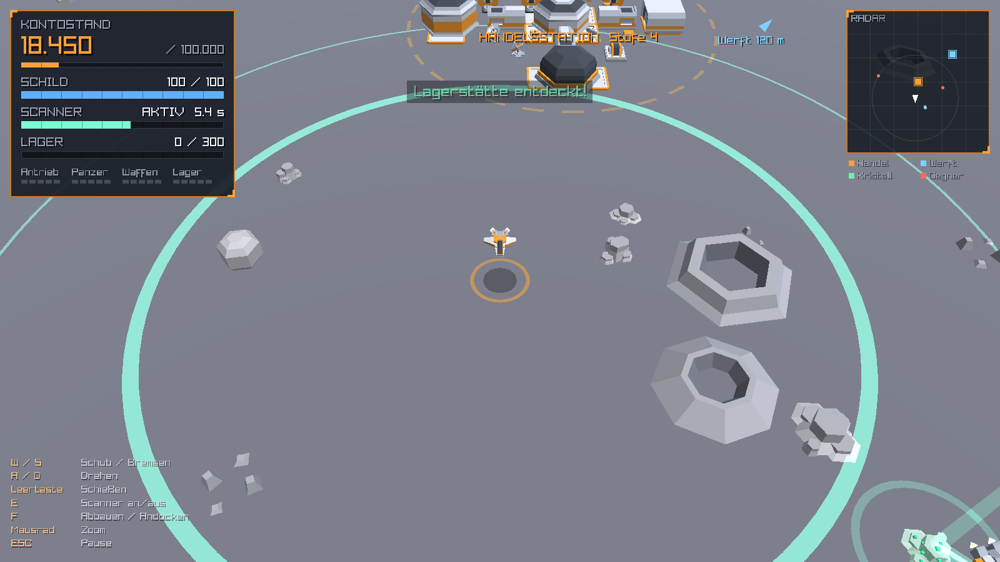
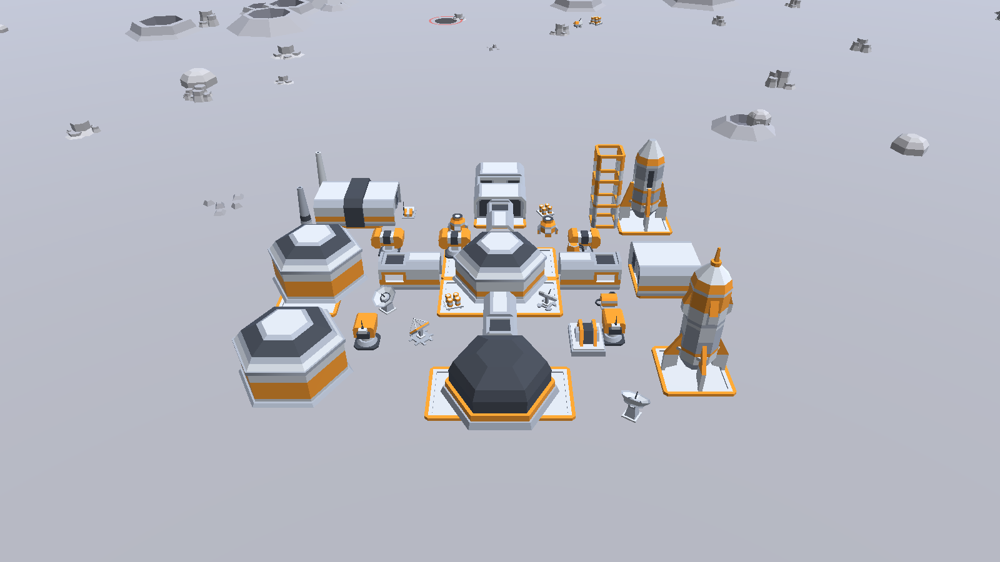

# Mondschürfer

Ein kleines 3D-Weltraumspiel in C++ (raylib), gebaut ausschließlich mit den Modellen
aus dem **Kenney Space Kit** und vertont mit den Kenney-Paketen **Sci-Fi Sounds** und
**Interface Sounds**; die Musik stammt von **dekker187**. Du fliegst ein Raumschiff über die Mondoberfläche, suchst
mit dem Scanner nach Kristallen, baust sie ab, verkaufst sie an der Handelsstation und
rüstest dein Schiff in der Werft auf. Piraten machen dir dabei das Leben schwer.

**Ziel:** 100.000 Ressourcenpunkte auf dem Konto.

Neben dem Einzelspieler gibt es einen **Mehrspieler**: Mehrere Piloten schürfen gleichzeitig auf
einem gemeinsamen Mond, den ein eigener Server rechnet (z. B. als Docker-Container auf einem
Raspberry Pi oder Heimserver). Mit Konten, Bestenliste, Zuschauermodus und einer kleinen
Verwaltungs-Webseite für den Betreiber. Siehe [Mehrspieler](#mehrspieler).




---

## Bauen mit CLion

Das Projekt ist ein normales CMake-Projekt. CLion erkennt es automatisch.
raylib 5.5 wird beim ersten Laden des Projekts automatisch von GitHub geladen und mitgebaut
(einmalig Internet nötig, danach nicht mehr).

### Windows

1. Ordner `Mondschuerfer` in CLion öffnen (*File → Open*).
2. Toolchain: die mitgelieferte **MinGW**-Toolchain von CLion reicht (Standard).
   Visual Studio (MSVC) funktioniert ebenfalls.
3. Warten, bis CMake fertig ist, dann die Konfiguration **Mondschuerfer** starten (▶).

Die `.exe` ist statisch gelinkt und läuft auch außerhalb von CLion, solange der Ordner
`assets` daneben liegt (wird beim Bauen automatisch kopiert). Bei MinGW-Toolchains, die
keinen vollständig statischen Link erlauben (z. B. die mit CLion mitgelieferte GCC 15),
werden zusätzlich `libwinpthread-1.dll` und `libgcc_s_seh-1.dll` neben die `.exe` kopiert.
Diese gehören dann beim Weitergeben dazu.

### Linux (Pop!_OS, Ubuntu, Debian)

1. Entwicklerpakete installieren (für raylib/GLFW):
   ```bash
   sudo apt install build-essential cmake git libx11-dev libxrandr-dev libxinerama-dev libxcursor-dev libxi-dev libgl1-mesa-dev
   ```
2. Ordner `Mondschuerfer` in CLion öffnen.
3. Warten, bis CMake fertig ist, dann **Mondschuerfer** starten (▶).

### Ohne CLion (Kommandozeile)

```bash
cmake -S . -B build -DCMAKE_BUILD_TYPE=Release
cmake --build build
./build/Mondschuerfer        # Windows: build\Mondschuerfer.exe
```

### Was gebaut wird: CMake-Optionen

| Option | Standard | Baut |
|---|---|---|
| `MONDSCHUERFER_CLIENT` | `ON` | das Spiel `Mondschuerfer` (Einzelspieler **und** Mehrspieler-Client), braucht raylib |
| `MONDSCHUERFER_SERVER` | `OFF` | den Mehrspieler-Server `mondschuerfer-server` und das Messwerkzeug `mondschuerfer-loadtest` (ohne Grafik, ohne raylib-Bibliothek) |

Beide lassen sich kombinieren, z. B. Spiel und Server in einem Build-Ordner:
`cmake -S . -B build -DMONDSCHUERFER_SERVER=ON`. In CLion trägt man die Option unter
*Settings → Build, Execution, Deployment → CMake → CMake options* ein.

Die Netzwerkbibliothek **ENet** und der Webserver **cpp-httplib** liegen im Projekt unter
`third_party/` und werden mitgebaut; dafür ist kein Download nötig. Heruntergeladen wird nur
raylib für das Spiel (falls es nicht installiert ist).

### Mehrspieler-Server ohne Docker bauen

Der Server braucht nur einen C++17-Compiler und CMake (≥ 3.16), kein raylib und kein Internet:

```bash
cmake -S . -B build/srv -DMONDSCHUERFER_CLIENT=OFF -DMONDSCHUERFER_SERVER=ON -DCMAKE_BUILD_TYPE=Release
cmake --build build/srv --target mondschuerfer-server mondschuerfer-loadtest -j

# Starten. Die Webseite ist so nur auf diesem Rechner erreichbar. Ohne ADMIN_USER/ADMIN_PASSWORD
# (Passwort mind. 10 Zeichen) startet nur das Spiel, nicht die Webseite.
ADMIN_USER=mondverwalter ADMIN_PASSWORD='hier-ein-langes-passwort' \
    ./build/srv/server/mondschuerfer-server --data ./data --web-bind 127.0.0.1
```

`mondschuerfer-server --help` zeigt alle Optionen. Betrieb mit Docker, Einstellungen, Ports,
Sicherheit und Datensicherung: [server/README.md](server/README.md).

---

## Steuerung

Gespielt wird mit Tastatur, mit Tastatur und Maus oder mit einem Gamecontroller (Xbox oder
PlayStation). Alle Geräte gehen jederzeit, auch gemischt. Die Tastenhilfe unten links, die
Hinweise wie „[F] Andocken“ und die Hilfe im Pausenmenü passen sich dem zuletzt benutzten Gerät
an (mit Controller z. B. „[Y] Andocken“ bzw. „[Dreieck] Andocken“). Eine Übersicht steht auch in
den **Optionen**.

**Tastatur**

| Taste | Aktion |
|---|---|
| W / S oder ↑ / ↓ | Schub vorwärts / bremsen, rückwärts |
| A / D oder ← / → | Drehen |
| Leertaste | Schießen (2 Schuss pro Sekunde) |
| E | Scanner an / aus |
| F | Abbauen (an Lagerstätte oder Wrack) / Andocken (an Station) / Person einsammeln (Mission) |
| R | Schild reparieren (an der Handelsstation) |
| 1 – 4 | Upgrade kaufen (in der Werft) / Schiff kaufen (beim Raumschiffsverkäufer, mit Umschalt: in Zahlung geben) |
| 1 – 3 | Schiff wechseln (Handelsstation, Tab „Schiff“) / Mission annehmen (Tab „Missionen“) |
| Tab | Karteireiter der Handelsstation wechseln (Station / Schiff / Missionen) |
| ESC / P | Pause |
| Enter | Chat (nur Mehrspieler): Eingabe öffnen, mit Text noch einmal Enter = senden, ESC = abbrechen |
| H | Steuerung einblenden |
| M | Ton an / aus |
| F11 | Vollbild |

**Maus** (zusätzlich zur Tastatur; Schießen, Scanner und Andocken bleiben auf Leertaste, E und F)

| Maus | Aktion |
|---|---|
| Linksklick auf den Boden | Das Schiff fliegt dorthin und hält dort an. Das Ziel zeigt ein pulsierender oranger Ring. |
| Linke Maustaste halten | Das Schiff folgt dem Mauszeiger (je weiter weg der Zeiger, desto schneller). |
| Rechte Maustaste | Flugziel löschen |
| Mausrad | Zoom (bei offener Chat-Eingabe über dem Chatfenster: im Chatverlauf blättern) |

Lenkt man mit W/A/S/D (oder dem Controller), wird ein Mausziel gelöscht. Klicks auf Fenster des
HUD (Statusfenster, Radar, Hinweise) setzen kein Ziel. Liegt das Ziel in einer Station, kommt
das Schiff nicht ganz hin; nach 4 Sekunden ohne Fortschritt wird das Ziel aufgegeben.

**Controller** – raylib erkennt die Knöpfe an ihrer *Lage*, deshalb gilt dieselbe Belegung an
denselben Stellen für Xbox- und PlayStation-Controller:

| Aktion | Xbox | PlayStation |
|---|---|---|
| Flugrichtung (das Schiff dreht sich dorthin, wohin der Stick **im Bild** zeigt) | Linker Stick | Linker Stick |
| Tempo (halb gedrückt = halbe Höchstgeschwindigkeit) | RT (rechter Trigger) | R2 |
| Bremsen / rückwärts | LT (linker Trigger) | L2 |
| Schießen | A | Kreuz |
| Scanner an / aus | B | Kreis |
| Abbauen / Andocken / Abdocken | Y | Dreieck |
| Pause (Menü) | Menü-Taste (drei Striche) | Options (rechts neben dem Touchpad) |
| Zoom | Rechter Stick hoch / runter | Rechter Stick hoch / runter |

Alternativ gibt es in den **Optionen → Steuerung** die **Tank-Steuerung**: Dann fliegt das Schiff
mit dem linken Stick nach vorn geneigt vorwärts in Richtung seiner Nase (halb geneigt = halbes
Höchsttempo), nach hinten geneigt rückwärts, und links / rechts dreht es sich. RT / LT
gelten dabei weiter (und gehen dem Stick vor).

**In allen Menüs** (Hauptmenü, Pause, Optionen, Stationsfenster, Mehrspieler-Menüs, Zuschauen)
bewegt der linke Stick den Mauszeiger (zusätzlich als oranger Ring gezeichnet), **A** (Kreuz)
klickt, das **Steuerkreuz** wählt in Knopflisten wie die Pfeiltasten, **B** (Kreis) heißt
„zurück“ wie ESC, die Menü-Taste schließt die Pause wieder. Im Stationsfenster dockt **Y**
(Dreieck) wie F ab. Lautstärkeregler: A halten und ziehen, oder Steuerkreuz links/rechts.
Texteingaben (Serveradresse, Name, Passwort) brauchen die Tastatur.

**Zu Fuß als SG-Team** (FPS-Modus, bisher nur im Einzelspieler zum Ausprobieren): In der Pause
steigt man mit *Als SG-Team aussteigen* unter dem Schiff aus und läuft in der Ego-Ansicht über
den Mond; *Ins Schiff einsteigen* holt das Schiff an diese Stelle zurück. Gespeichert wird immer
mit dem Schiff. Etwa 40 % der Kristalle sind **gelb** und ohne Scanner zu sehen: Schiffe bauen sie
nicht ab, erst muss zu Fuß eine Probe genommen werden (3 Sekunden halten). Danach ist der Kristall
wieder grün, und Piloten wie Händler können ihn abbauen.

Mit dir steigen drei **Kameraden** (SG1-2 bis SG1-4) aus. Sie folgen dir in einer Reihe hinter dir
und schießen auf Gegner in Sichtweite; gefallene Kameraden kommen nach 20 Sekunden zurück. An
gelben Kristallen, mindestens 60 m entfernt, streifen Gruppen von zwei bis vier **Bodenpiraten**
umher. Sie greifen an, sobald sie dich oder einen Kameraden sehen, und ziehen sich mit wenig Schild
zurück. Ist eine Gruppe ausgeschaltet, kommt später eine neue. Der Schild lädt sich nach 5 Sekunden
ohne Treffer wieder auf. Fällst du, verlierst du deine getragenen Proben und stehst nach
5 Sekunden am Ausstiegspunkt wieder auf.

| Aktion | Tastatur / Maus | Xbox | PlayStation |
|---|---|---|---|
| Laufen | W / S, A / D | Linker Stick | Linker Stick |
| Zielen | Maus | Rechter Stick | Rechter Stick |
| Schießen | Linksklick | RT | R2 |
| Springen | Leertaste | A | Kreuz |
| Sprinten | Shift halten | Linken Stick drücken | Linken Stick drücken |
| Nachladen | R | X | Quadrat |
| Probe nehmen (am gelben Kristall) | E halten | B halten | Kreis halten |

**Im Mehrspieler** gelten dieselben Tasten. Unterschiede:

| Taste | Aktion im Mehrspieler |
|---|---|
| ESC / P (Controller: Menü-Taste) | Pause mit *Weiterspielen*, *Optionen* oder *Abmelden & zum Hauptmenü* (der Server speichert dann deinen Fortschritt). Die Welt läuft während der Pause (und in den Optionen) weiter, dein Schiff bekommt nur keine Steuerbefehle. |
| ESC / F im Stationsfenster (Controller: B / Y) | Abdocken |
| Tab | im Anmeldefenster zwischen Name und Passwort wechseln |
| Zuschauer: Mausrad / Ziehen / R / ESC | Zoom / Karte verschieben / ganze Karte / Zuschauen beenden (Controller: rechter Stick / A halten und linken Stick bewegen / – / B) |

---

## Spielregeln

**Startmenü:** Neues Spiel · Fortsetzen · Mehrspieler · Karteneditor · Simulation (spielt selbst) · Optionen · Beenden

Gibt es eigene Karten, fragt *Neues Spiel* zuerst nach der Karte: *Standardkarte (Zufall)* wie
bisher oder eine Karte aus dem Karteneditor. Der Spielstand merkt sich die Karte.

Auf der Karte ist Leben (nur Kulisse, ohne Einfluss aufs Spiel, auch im Mehrspieler): Rover fahren
um Felsen und Krater herum und hinterlassen Reifenspuren, die nach einer einstellbaren Zeit
verblassen (Optionen → Grafik). Eine Monorail verbindet die Stationen; der Zug hält an jedem Ende
10 Sekunden. Neben jeder Station startet oder landet alle 20 bis 30 Sekunden eine Rakete. Fünf Tore
öffnen einmal pro Minute kurz ein leuchtendes Wurmloch, und entdeckte Kristalle glimmen.

- **Scanner (E):** Kristall-Lagerstätten sind unsichtbar, bis der Scanner sie erfasst.
  Der Scanner hat 10 Energieeinheiten und verbraucht 1 pro Sekunde, er läuft also höchstens
  10 Sekunden und schaltet sich dann ab. Ausgeschaltet lädt er 1 Einheit pro Sekunde nach.
  Entdeckte Lagerstätten bleiben markiert (grüner Lichtstrahl, grüne Punkte auf dem Radar).
- **Abbau (F):** In der Nähe einer entdeckten Lagerstätte F drücken. Nach **5 Sekunden** ist das
  Lager gefüllt, sofern die Lagerstätte genug hergibt. Weiter draußen liegen ergiebigere Vorkommen.
- **Handelsstation:** Andocken (F) verkauft die komplette Ladung, 1 Ressource = 1 Punkt.
  Dort kann auch der Schild repariert werden (2 Punkte pro Schildpunkt).
  Je mehr Ressourcen insgesamt abgeliefert wurden, desto größer wird die Station:
  8 Ausbaustufen mit Korridoren, Hangars, Kuppeln, Antennen, Geschütztürmen und Raketen.
- **Werft:** Upgrades für Antrieb (Tempo), Panzerung (maximaler Schild), Bewaffnung
  (Schaden und Feuerrate) und Lager (Kapazität), jeweils 5 Stufen. Bezahlt wird mit
  Ressourcenpunkten, das senkt also den Kontostand.
- **Raumschiffsverkäufer** (lime-grüne Station südlich der Mitte): Hier gibt es weitere Schiffe.
  Beim Kauf wird das alte Schiff geparkt, oder du gibst es in Zahlung (50 % von Kaufpreis und
  bezahlten Upgrades werden gutgeschrieben). Jedes Schiff hat eigene Upgrades, sie lassen sich
  nicht übertragen. Zwischen den eigenen Schiffen wechselst du an der Handelsstation im Tab „Schiff“.

  | Schiff | Schild | Scanner | Antrieb | Waffen | Lager | Preis |
  |---|---|---|---|---|---|---|
  | Startschiff | 100 | 50 % | 100 % | 100 % | 300 | – |
  | The Cargo | 120 | 150 % | 80 % | 120 % | 1.200 | 20.000 |
  | Hunter | 80 | 30 % | 100 % | 160 % | 300 | 15.000 |
  | Speedster | 60 | 60 % | 130 % | 80 % | 150 | 10.000 |

  Die Prozente beziehen sich auf die Grundwerte (Scanner 34 m, Tempo 16, Schaden 10).
- **Mini-Missionen:** An der Handelsstation im Tab „Missionen“ nimmst du eine Mission an (immer
  nur eine gleichzeitig). Die Belohnung kommt sofort aufs Konto. Ziele stehen pulsierend auf
  dem Radar, der Fortschritt oben in der Mitte, der Funkspruch (Videoclip mit Untertitel) unten rechts.
  - *Personen einsammeln* (2.000 Punkte): drei Personen (gelb) mit F abholen und an einer
    Handelsstation abliefern.
  - *Piraten abschießen* (2.500 Punkte): drei Missionspiraten (rot) abschießen.
  - *Konvoi verteidigen* (3.500 Punkte): drei Frachter (grün) fliegen zu einer anderen Station,
    unterwegs greifen zwei Piratenwellen an. Kommt keiner an, ist die Mission gescheitert.
  Stürzt du ab, scheitert die Mission, und das Angebot steht wieder an der Station.
- **Kampf:** Leertaste feuert 2 Schuss pro Sekunde mit je 10 Schaden. Dein Schild hat zu Beginn
  100 Punkte: nach 10 Treffern stürzt das Schiff ab, und das Spiel ist zu Ende.
  - *Piraten* (rötlich) greifen an, sobald du in ihre Nähe kommst.
  - *Händler/Miner* bauen selbst Kristalle ab und wehren sich nur, wenn du sie angreifst.
  - Abgeschossene Schiffe stürzen ab und hinterlassen ein **Wrack**, das du wie eine
    Lagerstätte abbauen kannst (orangefarbener Lichtstrahl).
  - Die Geschütztürme der Stationen schützen dich vor Piraten.
- **Fortsetzen:** Das Spiel speichert automatisch beim Andocken und beim Schließen des Fensters,
  außerdem über *Pause → Speichern & zum Hauptmenü*. Der Spielstand liegt als
  `mondschuerfer_spielstand.txt` neben der ausführbaren Datei. Nach Sieg oder Absturz wird er gelöscht.
- **Simulation:** Ein Autopilot spielt selbst: scannen, abbauen, verkaufen, kämpfen, aufrüsten.
  Eine beliebige Taste führt zurück ins Menü.
- **Karteneditor:** Zuerst kommt die Liste der gespeicherten Karten mit *Karte laden* und *Neu*
  (leere Karte). Eine Karte ist nur Kulisse ohne Kollision: Gelände, Krater, Felsen, Straßen,
  Monorail, Gebäude und Fundstücke. Stationen stehen an ihren festen Plätzen (der Editor zeigt
  alle möglichen Bauplätze), Kristalle und Piraten erscheinen wie bisher zufällig.
  Links im Werkzeugfenster wählst du ein Segment, *Zufall generieren* füllt die Karte mit Kratern,
  Felsen und Fundstücken (Straßen, Monorail und Gebäude bleiben stehen). Bilden die
  Monorail-Schienen einen geschlossenen Kreis, fährt darauf ein Zug, im Editor und im Spiel.
  Gesetzte Mondfahrzeuge fahren im Spiel los, gesetzte Tore leuchten einmal pro Minute auf. Die
  Monorail zwischen den Stationen und die Raketenstartplätze zeigt der Editor mit an.
  Gespeichert wird im Ordner `karten` neben der ausführbaren Datei.
  *An Server senden* schickt die Karte an einen Mehrspieler-Server (Anmeldung mit Spielername und
  Passwort). Das geht nur, wenn der Betreiber es dem Spieler auf der Verwaltungsseite erlaubt hat;
  dort wählt er auch, welche Karte alle Spieler sehen.

  | Eingabe | Wirkung |
  |---|---|
  | Linksklick (halten) | Segment setzen (malen), es rastet im 3-m-Raster ein |
  | Rechtsklick (halten) | Teil unter dem Zeiger löschen (radieren) |
  | R | Segment um 90° drehen |
  | WASD / Pfeiltasten / mittlere Maustaste ziehen | Ansicht verschieben |
  | Mausrad | zoomen |
  | Strg+S | speichern |
  | ESC | Auswahl aufheben, dann zurück zur Kartenliste |

Alle Balancing-Werte (Preise, Upgrades, Gegner, Ausbaustufen ...) stehen in `shared/Config.hpp`
(sie gelten für Einzelspieler und Server gleichermaßen).

---

## Mehrspieler

Im Mehrspieler fliegen mehrere Piloten über denselben Mond. Die Welt rechnet ein **Server**; das
Spiel schickt ihm nur deine Tasten und zeigt, was er zurückmeldet (dein eigenes Schiff sagt es
dabei selbst voraus, damit sich die Steuerung direkt anfühlt).

### Mitspielen

1. **Hauptmenü → Mehrspieler.**
2. **Serveradresse** eingeben: `localhost`, eine LAN-Adresse wie `192.168.1.20` oder ein Name wie
   `mein-server.de`, optional mit Port (`:7777` ist Standard). → **Verbinden**.
   Das Spiel merkt sich Adresse und Spielernamen in `mondschuerfer_client.txt` neben der
   ausführbaren Datei (das Passwort nie; siehe [Musik und Optionen](#musik-und-optionen)).
3. In der **Lobby** stehen Servername, Spieler online und die Einstellungen des Servers.
   Dann wählen:
   - **Zuschauen** – ohne Konto die ganze Karte von oben ansehen, mit Spielerliste und
     Bestenliste (bis zu 16 Zuschauer).
   - **Mitspielen** – Name und Passwort eingeben:
     - **Neues Konto anlegen** beim ersten Mal. Name: 3–16 Zeichen, nur Buchstaben (A–Z),
       Ziffern, `_` und `-`; jeden Namen gibt es pro Server nur einmal (Groß/Klein egal).
       Passwort: mindestens 6 Zeichen.
     - **Anmelden** bei jedem weiteren Mal – du spielst mit deinem letzten Stand weiter.
4. **Abmelden:** ESC → *Abmelden & zum Hauptmenü*. Der Server speichert deinen Fortschritt.

Das Passwort verlässt deinen Rechner nicht: Das Spiel berechnet daraus einen Schlüssel, und nur
damit meldet es sich an. Die Spielverbindung selbst ist aber **nicht verschlüsselt** – nimm für das
Spiel ein eigenes Passwort, das du sonst nirgends benutzt.

### Regeln im Mehrspieler (kurz)

- Grundregeln wie im Einzelspieler; jeder hat **eigenen** Kontostand, eigene Aufrüstungen und muss
  Lagerstätten **selbst** entdecken. Abbauen kann sie aber jeder – wer zuerst kommt …
- **Absturz:** Nach 4 Sekunden gibt es ein neues Schiff an einer Handelsstation, aber der
  Fortschritt (Kontostand, Aufrüstungen, gekaufte Schiffe, Runde, Schiffszeit) beginnt **von vorn**.
- **Schiffszeit:** wie lange du schon mit dem aktuellen Schiff fliegst.
- **Ziel erreicht** (100.000 Punkte): Eintrag in die **Bestenliste** (die schnellsten Runden),
  alle Spieler sehen es, und eine **neue Runde** beginnt mit Kontostand 0 – die Aufrüstungen
  behältst du.
- Was alle zusammen abliefern, lässt die Handelsstationen wachsen.
- Die **Pause** hält die Welt nicht an.
- Die Anzahl der Piraten, Stationen, die Mondfarbe und die maximale Spielerzahl stellt der
  Betreiber des Servers ein.

### Einen Server betreiben

Am einfachsten mit Docker: `cp .env.example .env`, darin `ADMIN_PASSWORD` setzen, dann
`docker compose up -d --build`. Die Spieler verbinden sich über **UDP-Port 7777**, die
Verwaltungs-Webseite (Auslastung, Spieler, Bestenliste, Einstellungen) liegt auf
<http://localhost:8080>. Alles Weitere – Einstellungen, Ports und Router, Hardware-Empfehlung,
Sicherheit, Datensicherung, Updates, Fehlersuche, Betrieb ohne Docker –
steht in **[server/README.md](server/README.md)**.

### Wie funktioniert das?

Wer aus dem Code lernen möchte, wie der Mehrspieler aufgebaut ist (geteilte Spiellogik,
Netzwerkprotokoll, Vorhersage und Interpolation, Anmeldung, Threads im Server …), findet eine
ausführliche Erklärung mit Leseempfehlung und Übungen in
**[docs/Mehrspieler.md](docs/Mehrspieler.md)**.

---

## Ton

Schüsse, Treffer, Explosionen, Scanner, Abbau, Andocken, Stationen und Menüs haben eigene
Soundeffekte. Triebwerk, Schub, Scanner und Abbau laufen als Dauergeräusch, bei kritischem
Schild ertönt ein Warnton. Geräusche anderer Schiffe werden mit der Entfernung leiser und
kommen von links oder rechts. Die Hintergrund-Simulation im Hauptmenü bleibt stumm (dort läuft
nur die Menümusik, siehe [Musik und Optionen](#musik-und-optionen)).

Welche Datei zu welchem Ereignis gehört, steht in der Tabelle `kSfx` (und `kLoops`) in
`src/Audio.cpp`. Dort lassen sich Dateien, Lautstärke und Tonhöhen-Variation anpassen.
Einträge mit dem Kommentar *Notlösung* sind mit dem nächstbesten Ton belegt, weil die beiden
Pakete nichts wirklich Passendes enthalten. Ohne Audiogerät läuft das Spiel stumm weiter.

---

## Musik und Optionen

Die Musikstücke von **dekker187** (erstellt mit Suno) liegen in `assets/music/`:

| Stück | Datei | Läuft … |
|---|---|---|
| *Main Menu Theme* | `main_menu_theme.mp3` | im Hauptmenü, in den Optionen aus dem Hauptmenü und in den Mehrspieler-Menüs (Serveradresse, Lobby, Anmeldung); Endlosschleife |
| *Lunar Silence 01–03* | `lunar_silence_01.mp3` … `_03.mp3` | im Spiel: Einzelspiel samt Pause und Endbildschirmen, Simulation, Mehrspieler-Spiel und Zuschauen; nacheinander, nach dem dritten wieder das erste |
| *Entering Pirate Territory* | `enteringPirateTerritory.mp3` | im Spiel, solange die eigene Mini-Mission „Piraten abschießen“ läuft (Endlosschleife, beginnt jedes Mal von vorn) |
| *Deep Space Horizon* | `deepSpaceHorizon.mp3` | einmal, sobald man das Ziel (100.000) erreicht; danach wieder die Spielmusik |

Beim Wechsel zwischen den Stücken blendet die Musik weich über (das alte Stück wird in 1 s
leiser, das neue in 1,5 s lauter). Menü- und Spielmusik, die gerade nicht laufen, werden angehalten
und setzen später an derselben Stelle fort.

**Optionen** (Hauptmenü → *Optionen*, oder in der Pause → *Optionen*) mit drei Karteireitern:

*Ton*
- **Musik: An / Aus** – Umschalter (Mausklick, oder Zeile wählen und Enter).
- **Musiklautstärke** – Schieberegler in 5-%-Schritten (mit der Maus ziehen oder ← / → drücken).
  Die Änderung ist sofort zu hören.
- **Clip-Lautstärke** – Lautstärke der Funkspruch-Clips der Missionen, ebenfalls in 5-%-Schritten
  (Standard 100 %; der Ton jedes Clips wird beim Laden auf volle Lautstärke gebracht).
- **Untertitel einblenden: An / Aus** – Text neben den Funkspruch-Clips unten rechts (Missionen,
  Begrüßung bei *Neues Spiel* und *Fortsetzen*); Standard an. Aus = nur Clip und Überschrift.

*Grafik* (wirkt auf die 3D-Welt; HUD und Menüs bleiben scharf)
- **Tilt-Shift** – Kameraeffekt, der die Welt wie ein Miniaturmodell wirken lässt: Die Bildmitte
  bleibt scharf, nach oben und unten wird das Bild unscharf.
  Schieberegler in 10-%-Schritten, ganz links „Aus“. Wirkt sofort, im Spiel wie in den
  Menü-Hintergründen.
- **Kantenglättung** – glättet die Kanten der 3D-Welt (MSAA). Regler mit den Stufen Aus, 2x, 4x,
  8x und 16x; Standard 4x. Kann die Grafikkarte eine Stufe nicht, steht daneben, wie viel sie
  kann, und es wird diese Stufe benutzt.
- **FXAA** – glättet Kanten zusätzlich per Shader; Regler in 10-%-Schritten, ganz links „Aus“
  (Standard). Lässt sich zusammen mit der Kantenglättung einschalten.
- **Stil-Look** – Aus (Standard) oder Retro-Pixel fein, mittel, grob: Die 3D-Welt wird in große
  Pixel mit weniger Farbstufen zerlegt (wie 360, 240 bzw. 160 Bildzeilen). HUD und Menüs bleiben
  scharf; FXAA ist dabei ohne Wirkung.
- **Schatten** – Schiffe und andere bewegte Objekte (Rover, Züge, Raketen, Personen) werfen echte
  Schatten auf Boden, Stationen und Felsen (Schattenkarte). Stufen Aus, Niedrig, Mittel (Standard)
  und Hoch (schärfere Kanten, mehr Grafikspeicher). „Aus“ zeigt wie bisher runde Schatten unter den
  Schiffen.
- **Sandsturm** – Staub in der Farbe des Mondes, der die Sicht einschränkt: Nur ein Kreis um das
  eigene Schiff bleibt klar, weiter weg verschwinden andere Schiffe, Felsen und Leuchteffekte in
  wogenden Schwaden, dazu fliegen Sandkörner mit dem Wind. Regler in 10-%-Schritten (je stärker,
  desto kleiner der klare Kreis); Standard „Aus“. Nicht im Karteneditor und nicht in der
  Kartenübersicht des Zuschauers.
- **Triebwerksschweif** – kurzer Schweif aus glühenden Partikeln hinter den Triebwerken, solange
  ein Schiff Schub gibt: Aus, Kurz, Mittel (Standard) oder Lang.
- **Treffer-Aufblitzen** – wie stark Schiffe bei einem Treffer aufleuchten und Explosionen
  (zerstörte Schiffe) aufblitzen: ein Lichtball, der die Umgebung kurz anstrahlt, ganz nah am
  eigenen Schiff hellt sich das ganze Bild auf. Regler in 10-%-Schritten, Standard 100 %.
- **Bodensteine** – viele kleine, kantige Steine (Low-Poly) auf dem Boden, damit man zu Fuß nicht
  über eine glatte Fläche läuft: Aus, Nur zu Fuß (Standard) oder Immer (auch aus dem Schiff, nicht
  im Karteneditor und nicht in der Kartenübersicht des Zuschauers). Reine Optik, ohne Kollision.
- **Fahrspuren (Rover)** – wie lange die Reifenspuren der Rover sichtbar bleiben: Aus, 15 s, 30 s,
  1 min (Standard), 2 min oder 5 min. Danach verblassen sie; „Aus“ spart am meisten Leistung.

*Steuerung*
- Tank-Steuerung an / aus: wie der linke Stick des Controllers lenkt (aus = Flugrichtung im Bild,
  an = vor / zurück fliegen und links / rechts drehen, siehe oben).
- Übersicht der Flug- und Menütasten für Tastatur/Maus, Xbox- und PlayStation-Controller
  (alle übrigen Tasten, z. B. im Stationsfenster, stehen oben im Abschnitt „Steuerung“).

Bedienung:
- Maus: Karteireiter anklicken, Umschalter/Zeile anklicken, Regler ziehen.
- Tastatur: **Tab** nächste Seite (Umschalt+Tab vorige), ↑ / ↓ Zeile wählen (ganz oben die
  Karteireiter, dort wechselt ← / → die Seite), ← / → Regler verstellen, Enter umschalten, ESC zurück.
- Controller: **LB / RB** (PlayStation: L1 / R1) wechselt die Seite, Zeiger mit dem linken Stick,
  A klickt (Regler: A halten und ziehen), Steuerkreuz wie die Pfeiltasten, B zurück.

Die Taste **M** schaltet weiterhin jederzeit den *ganzen* Ton stumm (Effekte, Musik und Clips); die
Einstellungen in den Optionen bleiben dabei erhalten.

Die Einstellungen stehen zusammen mit Serveradresse und Spielername in
`mondschuerfer_client.txt` neben der ausführbaren Datei und gelten beim nächsten Start wieder:

```
server localhost:7777
name Anna
music 1
music_volume 0.50
clip_volume 1.00
subtitles 1
tilt_shift 0.50
msaa 4
fxaa 0.00
track_time 60
shadows 2048
sandstorm 0.00
trail 2
hit_flash 1.00
pixel_look 0
ground_stones 1
```

`music` und `subtitles` sind `1` (an) oder `0` (aus), `music_volume`, `clip_volume`, `tilt_shift`, `fxaa`, `sandstorm` und
`hit_flash` je eine Zahl von `0` bis `1`
(Punkt oder Komma; `0` = aus), `msaa` eine der Stufen `0`, `2`, `4`, `8`, `16`, `track_time` die
Sekunden der Fahrspuren (`0`, `15`, `30`, `60`, `120`, `300`), `shadows` die Auflösung der
Schattenkarte (`0`, `1024`, `2048`, `4096`), `trail` und `pixel_look` die Stufe `0` (aus) bis `3`, `ground_stones`
`0` (aus), `1` (nur zu Fuß) oder `2` (immer). Fehlt die Datei
oder eine Zeile, gelten die Standardwerte (Musik an, Musiklautstärke 50 %, Clip-Lautstärke 100 %, Untertitel an, Tilt-Shift 50 %,
Kantenglättung 4x, FXAA aus, Fahrspuren 1 min, Schatten Mittel, Sandsturm aus, Schweif Mittel, Aufblitzen 100 %,
Stil-Look aus, Bodensteine nur zu Fuß).

Im Code: `src/Options.*` (Bildschirm), `src/Audio.*` (Laden, Abspielen, Überblenden),
`src/MusicMix.hpp` (die Überblend-Rechnung, ohne raylib testbar), `src/TiltShift.*`
(Tilt-Shift, Kantenglättung, FXAA, Retro-Pixel), `src/Effects.*` (Schattenkarte, Sandsturm),
`src/Render.cpp` (Schweif, Explosionsblitze, Sandkörner), `src/ClientConfig.*` (Datei).

---

## Projektstruktur

```
Mondschuerfer/
├── CMakeLists.txt        CMake-Projekt (lädt raylib 5.5 automatisch; Optionen CLIENT/SERVER)
├── docker-compose.yml    Server als Docker-Container betreiben (ausführlich kommentiert)
├── .env.example          Vorlage für .env: Admin-Zugang und Startwerte des Servers
├── .dockerignore         was beim Bauen des Images an Docker geschickt wird
├── assets/
│   ├── models/*.glb      Alle 153 Modelle des Kenney Space Kit (unverändert)
│   ├── sounds/scifi/     Kenney Sci-Fi Sounds (73 Dateien, unverändert)
│   ├── sounds/interface/ Kenney Interface Sounds (100 Dateien, unverändert)
│   ├── music/            Musik von dekker187: main_menu_theme.mp3, lunar_silence_01–03.mp3 u. a.
│   └── Kenney_*_License.txt
├── shared/               Gemeinsamer Code für Spiel UND Server (ohne raylib-Funktionen)
│   ├── Config.hpp        Balancing (auch die Mehrspieler-Werte MP_*)
│   ├── World.hpp/.cpp    Spiellogik: Flug, Scanner, Abbau, Kampf, Stationen, Mehrspieler-Regeln
│   ├── WorldGen.cpp      Mondoberfläche, Stationsaufbau (alle Ausbaustufen), Lagerstätten
│   ├── MapAnim.cpp       Kartenanimation: Rover und Fahrspuren, Monorail zwischen Stationen, Raketen, Tore
│   ├── GameMap.*         Eigene Karten: Dateiformat, Segmente, Monorail-Kreise
│   ├── Ai.cpp            Verhalten von Piraten und Händlern, Autopilot für die Simulation
│   ├── GameSettings.*    Spielparameter des Servers (Schwierigkeit, Stationen, Mondfarbe ...)
│   ├── Protocol.*        Netzwerkprotokoll: Nachrichten, Kodieren/Dekodieren, Quantisierung
│   ├── Crypto.*          SHA-256, HMAC, PBKDF2 für die Anmeldung
│   ├── Models.*          Modellnamen <-> Nummern (ModelBounds.inc: Abmessungen der Modelle)
│   ├── SoundEvents.hpp   Geräusch-Ereignisse der Spiellogik
│   └── Util.*            kleine Hilfen (Text, Winkel, Abstände)
├── src/                  Das Spiel (raylib)
│   ├── main.cpp          Fenster, Menüs, Spielzustände, Kamera
│   ├── Render.cpp        3D-Darstellung und Effekte
│   ├── Hud.cpp/.hpp      HUD, Radar, Stations- und Endbildschirme
│   ├── Ui.cpp/.hpp       UI-Bausteine (Knöpfe, Schieberegler, Umschalter, Textfelder), Controller in Menüs
│   ├── Options.cpp/.hpp  Bildschirm "Optionen" (Karteireiter Ton, Grafik, Steuerung)
│   ├── TiltShift.cpp/.hpp Kameraeffekte: Tilt-Shift, Kantenglättung (MSAA), FXAA, Retro-Pixel (Werte aus den Optionen)
│   ├── Effects.cpp/.hpp  Grafikeffekte: Schattenkarte, Sandsturm, Bildblitz
│   ├── Controls.cpp/.hpp Flugsteuerung: Tastatur, Maus (Klick/Halten), Controller; Tastennamen
│   ├── ControlsMath.hpp  Rechnungen der Steuerung (Stick-Richtung, Trigger, Anflug), ohne raylib testbar
│   ├── Assets.cpp/.hpp   Modelle laden, Beleuchtungs-Shader
│   ├── Audio.cpp/.hpp    Soundeffekte, Dauergeräusche, Musik, Zuordnung Ereignis -> Datei
│   ├── ClipPlayer.cpp/.hpp Funkspruch-Clips der Missionen (assets/clips, MPEG-1)
│   ├── MusicMix.hpp      Überblenden der Musik (reine Rechnung, ohne raylib)
│   ├── Save.cpp/.hpp     Spielstand
│   ├── MapEditor.*       Karteneditor (Kartenliste, Werkzeuge, Raster) und Kartenauswahl
│   ├── MapFiles.*        Eigene Karten im Ordner "karten" speichern und laden
│   ├── NetClient.*       Mehrspieler: Verbindung, Anmeldung, Vorhersage, Interpolation
│   ├── Multiplayer.*     Mehrspieler: Menüs (Adresse, Lobby, Anmeldung), Spielen, Zuschauen
│   └── ClientConfig.*    Einstellungsdatei: Serveradresse, Spielername, Musik
├── server/               Der Mehrspieler-Server (ohne Grafik), Anleitung: server/README.md
│   ├── src/              main, GameServer, Accounts, SharedState, WebServer, LoadTest
│   ├── web/              Verwaltungs-Webseite (index.html, app.js, style.css)
│   ├── Dockerfile        Container-Image
│   └── Caddyfile         optionaler HTTPS-Vorbau für die Webseite
├── third_party/          Fremde Bibliotheken im Projekt (siehe third_party/README.md)
│   ├── enet/             ENet 1.3.18 (Netzwerk über UDP)
│   ├── httplib/          cpp-httplib 0.22.0 (Webserver der Verwaltungsseite)
│   ├── pl_mpeg/          pl_mpeg (Videoclips abspielen, nur das Spiel)
│   └── raylib/           nur raylib.h und raymath.h 5.5 (für den Server)
└── docs/
    ├── Mehrspieler.md    Wie der Mehrspieler funktioniert (zum Lernen aus dem Code)
    └── *.png             Bildschirmfotos
```

**Technischer Hinweis:** Die GLB-Dateien des Space Kits enthalten einen Knoten, den der
glTF-Parser von raylib ablehnt. `Assets.cpp` korrigiert das beim Laden im Speicher, die
Dateien selbst bleiben unverändert. Die orangefarbenen Gesteinsfarben des Kits werden beim
Laden in Mondgrau umgefärbt.

### Kommandozeilen-Optionen (nur für Tests)

`--mode sim|game|dock0|dock1|pause|continue|options`, `--seed N`, `--steps N` (Simulation beschleunigen),
`--report` (Fortschritt auf der Konsole), `--screenshot datei.png --shot-at Sekunden`,
`--quit-after Sekunden`. Im normalen Spiel werden sie nicht gebraucht.

Weitere Testoptionen: `--size B H` (Fenstergröße, mindestens 960 × 540), `--norender` (nichts zeichnen,
schnelle Läufe), `--nohud`, `--shot-every Sekunden` (Bildserie), `--cam PX PY PZ TX TY TZ` (feste Kamera),
`--zoom Z`, `--pos X Z`, `--scan`, `--thrust-test`, `--pirates N`, `--hp H`, `--balance N`, `--deliver N`
(Gesamtablieferung = Ausbaustufe der Stationen). Die Bedeutung jeder Option steht bei `TestOptions` in
`src/main.cpp`.

`--mode options` öffnet direkt die Optionen (für Bildschirmfotos). `--music-test` prüft die Musik: Es
spielt einen festen Ablauf durch (Menü, neues Spiel, Musik aus und wieder an, Lautstärke 20 %, zurück
ins Menü) und schreibt alle 0,25 s eine Zeile `MUSICTEST …` (Blenden, Lautstärken, läuft das Stück,
Position im Stück) nach stderr. Dafür braucht es ein Audiogerät. Achtung: Es speichert die
Musik-Einstellungen wie ein Spieler in den Optionen.

**Steuerung testen** (ohne echte Maus bzw. ohne Controller):

- `--mouse-test X Z` setzt im Einzelspiel ein Flugziel bei (X, Z), genau wie ein Linksklick auf
  diese Stelle am Boden. Mehrmals angegeben, kommt jeweils 4 s nach dem Ankommen das nächste Ziel.
  Alle 2 s und bei jedem Zielende steht eine Zeile `MOUSETEST …` auf stderr (Schiffsposition, Ziel,
  Abstand, Tempo, `ende=angekommen|aufgegeben|abgebrochen`). Beispiel:
  `--mode game --seed 3 --norender --mouse-test 0 60 --mouse-test 30 10 --quit-after 30`
- `--pad-test WINKEL TRIGGER` täuscht einen Controller vor: linker Stick dauerhaft in Richtung
  WINKEL (Grad im Bild, 0 = oben, 90 = rechts), rechter Trigger = TRIGGER (0 bis 1). Jede Sekunde
  eine Zeile `PADTEST …` mit der Flugrichtung im Bild (`bild=`) und dem Tempo (`speed=`, Soll:
  `soll_speed=`).
- `--pad-name NAME` täuscht einen Controller mit diesem Namen vor (z. B.
  `"DualSense Wireless Controller"`), damit Hilfetexte und HUD die Controller-Namen zeigen – für
  Bildschirmfotos.

Diese Optionen ändern das normale Spiel nicht; die Zeile `REPORT …` (`--report`) bleibt gleich.

Für Entwickler: `--dump-model-bounds > shared/ModelBounds.inc` misst alle Modelle in `assets/models`
neu und gibt die Tabelle aus, aus der der Server die Größe der Stationen kennt (nötig, wenn Modelle
hinzukommen oder sich ändern).

**Mehrspieler-Testoptionen** (starten direkt im Mehrspieler-Bildschirm, z. B. für automatische Tests
mit mehreren Spielen auf einem Rechner):

| Option | Wirkung |
|---|---|
| `--mp-connect ADRESSE` | sofort mit dem Server verbinden (`host` oder `host:port`) |
| `--mp-name NAME` | Spielername für die automatische Anmeldung |
| `--mp-pass PASSWORT` | Passwort dazu (nur für Tests – steht sichtbar in der Prozessliste!) |
| `--mp-register` | Konto anlegen; ist der Name schon vergeben, stattdessen anmelden |
| `--mp-spectate` | direkt zuschauen |
| `--mp-autopilot` | der Autopilot fliegt das eigene Schiff (wie die Simulation) |

Beispiel: Server lokal starten, dann zwei Testpiloten und einen Zuschauer:

```bash
./Mondschuerfer --mp-connect localhost --mp-name Testpilot1 --mp-pass geheim123 --mp-register --mp-autopilot
./Mondschuerfer --mp-connect localhost --mp-name Testpilot2 --mp-pass geheim123 --mp-register --mp-autopilot --size 960 540
./Mondschuerfer --mp-connect localhost --mp-spectate --report
```

Mit `--report` schreibt das Spiel alle 10 Sekunden eine Zustandszeile nach stderr (im Mehrspieler:
Phase, Spieler, Kontostand …).

---

## Lizenzen und Mitwirkende

- Grafik: **Kenney Space Kit** von Kenney (www.kenney.nl), CC0 1.0 (siehe `assets/Kenney_SpaceKit_License.txt`)
- Ton: **Kenney Sci-Fi Sounds** und **Kenney Interface Sounds** von Kenney (www.kenney.nl), CC0 1.0
  (siehe `assets/Kenney_SciFiSounds_License.txt` und `assets/Kenney_InterfaceSounds_License.txt`)
- Musik: **dekker187** (erstellt mit Suno), bereitgestellt vom Projektinhaber – *Main Menu Theme*
  und *Lunar Silence 01* (`assets/music/`)
- Bibliothek: **raylib** von Ramon Santamaria, zlib-Lizenz
- Im Projekt mitgeliefert unter `third_party/` (Einzelheiten in `third_party/README.md`):
  - **ENet** 1.3.18 von Lee Salzman, MIT-Lizenz (`third_party/enet/LICENSE`) – Netzwerk für Spiel und Server
  - **cpp-httplib** 0.22.0 von yhirose, MIT-Lizenz (`third_party/httplib/LICENSE`) – Webserver der Verwaltungsseite
  - **pl_mpeg** von Dominic Szablewski, MIT-Lizenz (im Kopf von `third_party/pl_mpeg/pl_mpeg.h`) – Videoclips der Missionen
  - **raylib**-Header `raylib.h` und `raymath.h` (5.5), zlib-Lizenz (`third_party/raylib/LICENSE`) – Datentypen
    und Vektor-Mathe für den Server
